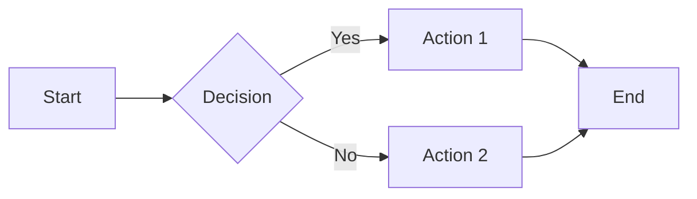
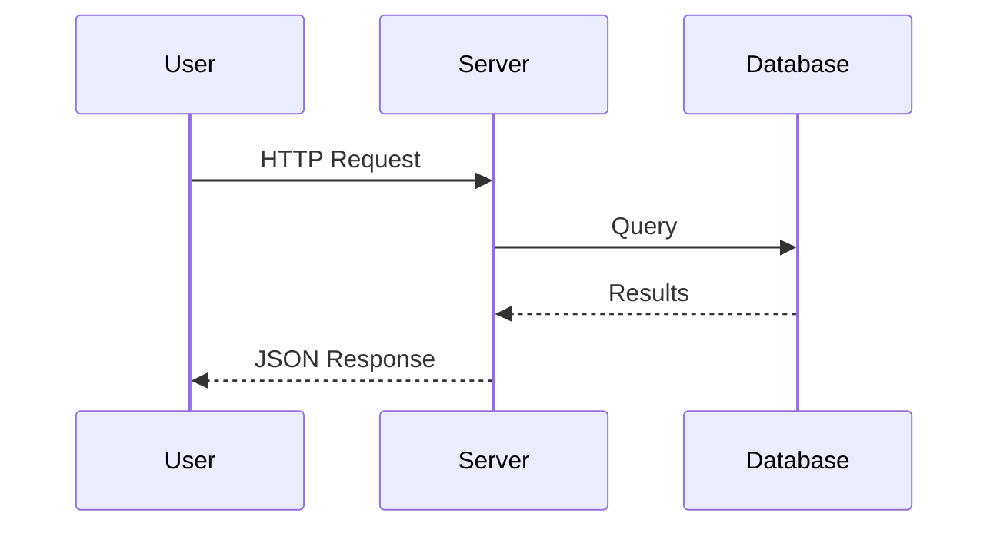
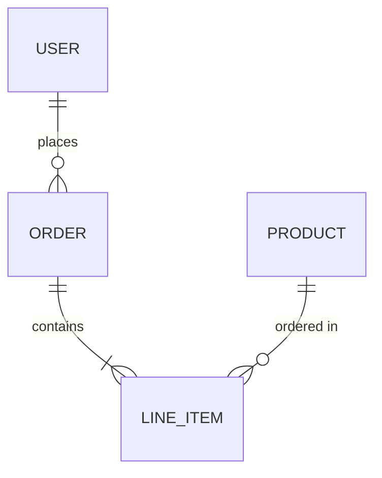
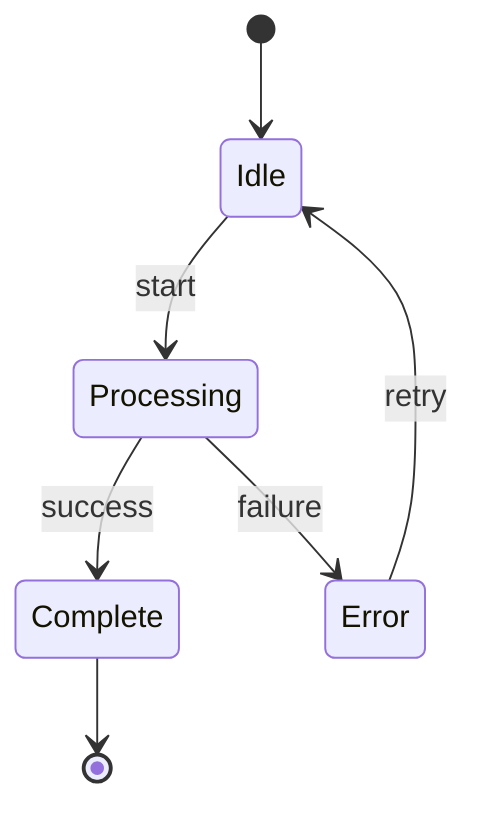
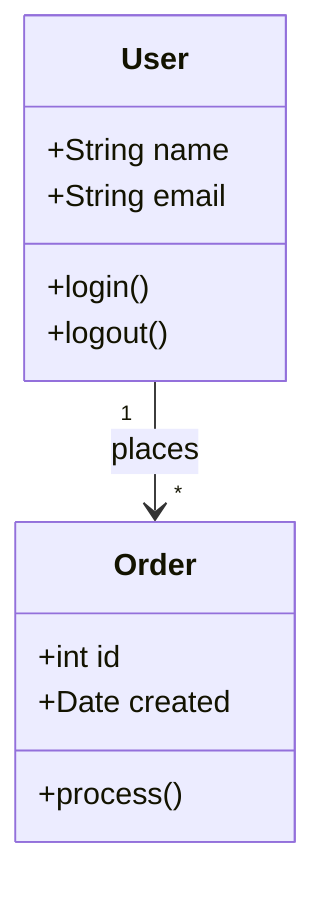
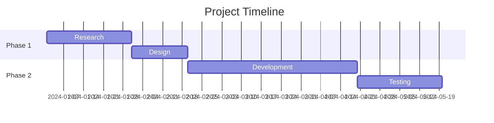
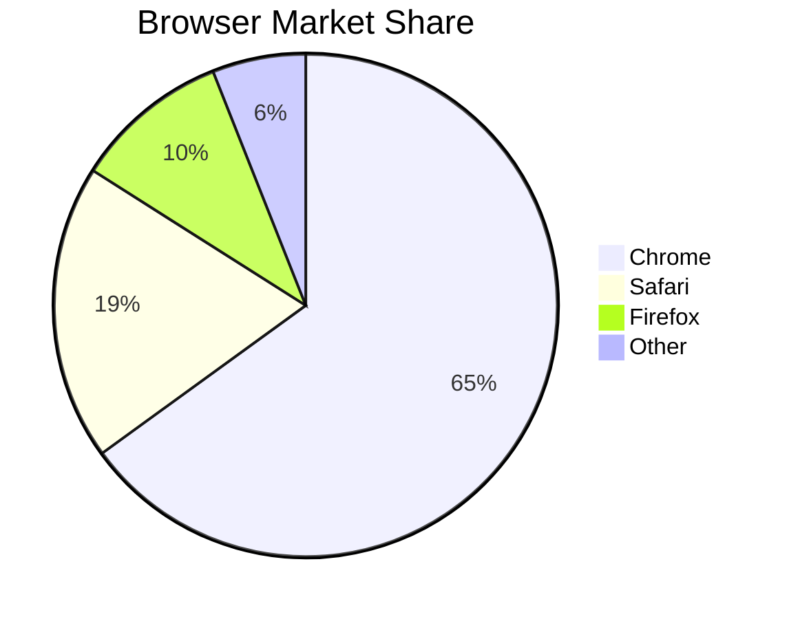
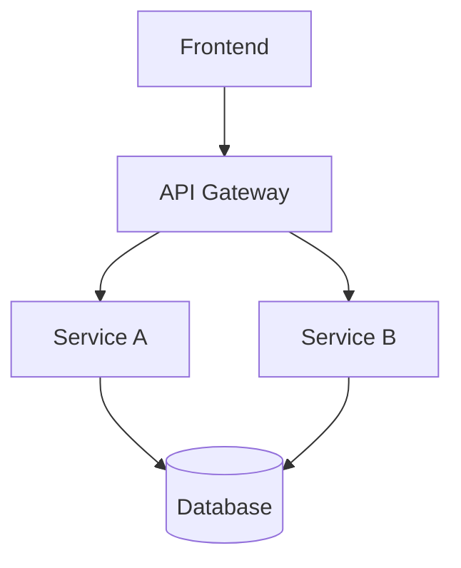
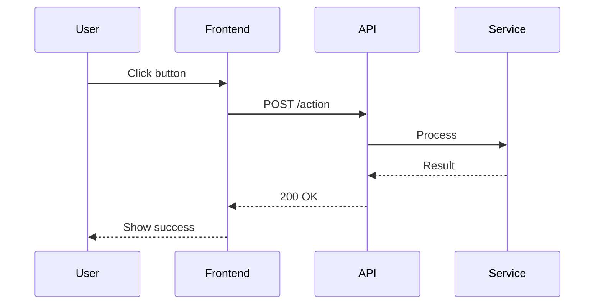

# Mermaid Diagram Examples

## Flowchart



## Sequence Diagram



## Entity Relationship Diagram



## State Diagram



## Class Diagram



## Gantt Chart



## Pie Chart



## Markdown Transformation Example

### Input (template.md)

~~~markdown
# Architecture Overview



# Request Flow


~~~

### Command

```bash
mmdc -i template.md -o docs/architecture.md -a docs/images/ -t default -b white
```

### Output (docs/architecture.md)

```markdown
# Architecture Overview


# Request Flow


```
